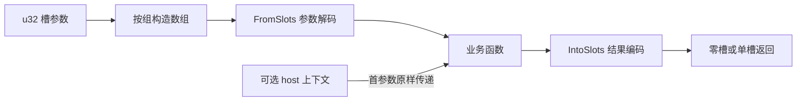

# abi-adapter 架构设计

abi-adapter 将由 32 位槽组成的 WebAssembly 函数接口映射到具有业务类型的 Rust 函数。核心由两个转换 trait 和一个声明宏组成，分别负责值表示和包装函数生成。

## 定位与职责边界

一个槽在 Rust 侧使用 `u32`，在 wasm32 函数签名中对应 `i32`。槽只承载位内容，字段含义、组合顺序和错误码由调用双方约定。

库在编译期生成适配代码，运行期依次执行参数解码、业务调用和结果编码。它采用 `no_std`，无第三方依赖；自身及生成代码不引入堆分配或 `unsafe` 块，自定义转换和业务代码保留各自的行为。

当前主要面向 wasm32 普通模块。运行时注册、线性内存访问、结果缓冲和资源生命周期属于集成方职责，组件模型接口不在当前范围内。

## 模块与数据流

| 文件 | 职责 |
| --- | --- |
| `src/lib.rs` | 声明模块、启用库级约束并导出公开接口 |
| `src/slots.rs` | 定义 `FromSlots<N>` 与 `IntoSlots<N>` |
| `src/impls.rs` | 提供有限的内置转换 |
| `src/boundary.rs` | 定义 `abi!` 及其展开规则 |

子模块均为私有模块。公开接口固定在 crate 根部：`FromSlots`、`IntoSlots` 和 `abi!`。模块调整必须保持这些路径的兼容性。



每个非空槽组对应一个业务参数。输入转换的目标类型由业务函数签名决定，槽宽度由数组长度决定；输出转换的类型由业务返回值决定。宏不读取业务函数定义，类型推断和调用检查均由 Rust 编译器完成。

## 代码生成模型

`host` 生成普通 Rust 包装函数，可将一个 `ctx` 参数原样传给业务函数；宿主运行时的注册由集成方完成。`guest("SYMBOL")` 生成带 `#[unsafe(export_name = "SYMBOL")]` 的 `extern "C"` 函数，不接受上下文参数。调用方属性和可见性只作用于包装函数。

以下声明将三个槽映射为两个业务参数：

```rust
fn score([x, y]: [u32; 2], scale: u32) -> u32 {
    (x + 10 * y) * scale
}

abi_adapter::abi! {
    host pub fn score_abi([x, y], [scale]) -> 1 => crate::score;
}
```

包装函数的语义等价于：

```rust
pub fn score_abi(x: u32, y: u32, scale: u32) -> u32 {
    abi_adapter::IntoSlots::<1>::into_slots(crate::score(
        abi_adapter::FromSlots::from_slots([x, y]),
        abi_adapter::FromSlots::from_slots([scale]),
    ))[0]
}
```

宏采用 `macro_rules!`，将 host / guest 的差异归一化后交给 `@emit` 生成同一套函数主体。`@return` 选择返回类型，`@encode` 执行结果转换，`@error` 处理已识别的声明错误。这些内部规则不属于公开调用接口。

直接返回宽度仅接受字面值 `0` 或 `1`：分别要求业务返回值实现 `IntoSlots<0>` 或 `IntoSlots<1>`，包装函数返回 `()` 或 `u32`。零槽返回仍执行编码，随后丢弃空数组。

## 关键设计决策

| 决策 | 原因与代价 |
| --- | --- |
| 用 `[u32; N]` 表达槽组 | 将宽度写入类型，避免运行时长度检查；同宽度的字段顺序和含义仍需协议测试 |
| 拆分输入与输出 trait | 类型只需实现实际使用的方向；接口不要求转换互逆，表示一致性由使用方保证 |
| 使用 `u32` 承载位内容 | 将边界表示与业务解释分离；例如浮点转换使用位操作，其他表示仍可由自定义类型选择 |
| 直接返回限定为零槽或单槽 | 保持 `(i32, …) -> ()` 或 `(i32, …) -> i32`，不引入隐藏参数或预设缓冲；多槽结果需要另行约定传递协议 |
| 只提供有限的内置转换 | 避免固定布尔值、枚举、宽整数等类型的表示；新增实现必须检查 trait 实现重叠和协议兼容性 |

转换接口按值接收或返回固定长度数组：

```rust
pub trait FromSlots<const N: usize>: Sized {
    fn from_slots(slots: [u32; N]) -> Self;
}

pub trait IntoSlots<const N: usize>: Sized {
    fn into_slots(self) -> [u32; N];
}
```

trait 可以表达任意宽度，包括零槽；宏的输入分组必须非空，直接返回仅支持零槽或单槽。扩展多槽返回必须先明确对外签名与结果传递协议，不能只放宽宏匹配规则。

## 实现约束与安全责任

- **求值顺序**：各参数组从左到右解码，全部完成后调用业务函数，再编码返回值。成功路径中每组转换、业务调用和结果编码各执行一次；panic 中断后续步骤，零槽编码的副作用不能省略。
- **宏匹配顺序**：正常声明必须位于与之重叠的错误回退之前。多个错误同时出现时，由最先匹配的规则决定诊断。
- **条件编译诊断**：错误放在保留原属性的函数体内，使声明中的 `cfg` / `cfg_attr` 能移除整个函数及诊断。错误分支不继续引用上下文类型或业务路径；无效返回宽度只在函数体内报错，避免重复诊断。声明属性只在宏成功匹配后生效。
- **名称隔离**：生成代码用 `$crate` 引用自身接口，用 `::core::primitive::u32` 和 `::core::compile_error!` 避免同名项干扰。调用方提供的名称仍按其作用域解析，业务目标宜使用限定路径。
- **转换与内存安全**：`FromSlots` 是安全接口，必须对任意输入位模式保持内存安全。两个 trait 没有专用错误通道；可恢复校验、地址有效性、缓冲区容量和资源权限由业务层处理。
- **导出安全**：guest 的导出属性要求使用方保证符号唯一及调用签名兼容。通过 `forbid(unsafe_code)` 检查不免除这些责任；外部宏生成属性的检查行为属于编译器兼容性验证范围。
- **panic 边界**：库不捕获 panic。host 遵循 Rust 的 panic 策略；guest 的 `extern "C"` 边界不允许向外展开，panic 导致终止，在 wasm 中表现为 trap，不保证终止前析构已转换值。

验证覆盖三个层次：转换的位语义；生成代码的调用顺序、条件编译及跨 crate 名称解析；实际 wasm 产物的签名与 trap 行为。槽顺序、状态码和内存协议的业务含义需要集成方另行验证。
